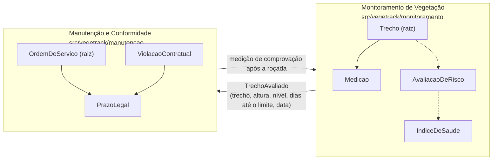

# Mapa de bounded contexts — VegeTrack

O modelo de domínio do Checkpoint 1 (Figura 2) se divide em **dois contextos**. Cada um tem a sua
pasta em `src/vegetrack/`, a sua linguagem e não importa o outro — o `import-linter` quebra o
pipeline se isso acontecer.

## 1. Monitoramento de Vegetação

- **Responsabilidade:** saber como a vegetação de cada trecho está e para onde está indo.
- **Conceitos:** Trecho, Medicao, AlturaVegetacao, MarcoQuilometrico, AvaliacaoDeRisco, NivelDeRisco, IndiceDeSaude.
- **Quem usa:** técnico de campo (Marcos) e coordenação (Renata) — personas do CP1.
- **Regras que moram aqui:** RN-01 (limite de 30 cm na classificação), RN-02 (altura de 0 a 300 cm), RN-03 (taxa entre duas medições; mesma data substitui).
- **Por que é um contexto:** muda por razão **agronômica e de coleta** — novo jeito de medir, nova fonte de levantamento, novo modelo de projeção (item S1 do backlog). Nada disso deveria tocar em ordem de serviço.

## 2. Manutenção e Conformidade

- **Responsabilidade:** transformar risco em trabalho de roçada e em situação contratual perante o regulador.
- **Conceitos:** OrdemDeServico, Prioridade, PrazoLegal, ViolacaoContratual, método de roçada, EPI.
- **Quem usa:** coordenação (Renata), equipes de roçada e gestor de contrato (Paulo).
- **Regras que moram aqui:** RN-04 (ordem só conclui com medição abaixo do limite), RN-05 (violação iminente vira configurada), RN-06 (uma ordem aberta por trecho), regras de método/equipes/EPI.
- **Por que é um contexto:** muda por razão **contratual e operacional** — renegociação com a ARTESP/ANTT, nova equipe terceirizada, novo EPI exigido pela NR. Nada disso muda como a vegetação é medida.

## Termos que mudam de significado entre os contextos

| Termo | No Monitoramento | Na Manutenção |
|---|---|---|
| **Trecho** | Agregado com marcos, sentido e histórico de medições | Apenas uma referência (`trecho_id`) — a ordem não conhece o histórico |
| **Prazo** | Projeção: dias até a vegetação atingir 30 cm (`dias_ate_o_limite`) | Obrigação: data-limite contratual para regularizar (`PrazoLegal`) |
| **Situação** | Nível de risco: Conforme, Atenção, Crítico | Ciclo de vida: Aberta, Em execução, Concluída (ordem) e Iminente, Configurada, Regularizada (violação) |
| **Altura** | Value object validado, com histórico | Número congelado que originou a ordem ou que comprovou a roçada |

Essas diferenças são a razão de existir a fronteira: se os dois contextos dividissem a mesma classe
`Trecho`, uma mudança no histórico de medições obrigaria a revisar a emissão de ordens.

## Relação entre os contextos

**Cliente-fornecedor** (Monitoramento fornece, Manutenção consome) por meio de um evento publicado
em linguagem própria, `TrechoAvaliado`. A tradução fica na camada de aplicação — o domínio de um
contexto nunca importa o do outro.

## Relação com o modelo do Checkpoint 1

| Classe do CP1 (Figura 2) | Contexto | Arquivo |
|---|---|---|
| Trecho, Medicao | Monitoramento | `monitoramento/dominio/trecho.py`, `medicao.py` |
| AvaliacaoDeRisco | Monitoramento | `monitoramento/dominio/avaliacao_de_risco.py` |
| AlturaVegetacao, MarcoQuilometrico, IndiceDeSaude «VO» | Monitoramento | `monitoramento/dominio/` |
| OrdemDeServico | Manutenção | `manutencao/dominio/ordem_de_servico.py` |
| ViolacaoContratual, PrazoLegal «VO» | Manutenção | `manutencao/dominio/` |
| Rodovia | — | Fora do código do MVP: há uma só rodovia (W2 Won't have) |
| EquipeDeRocada | Manutenção | Representada pelo número de equipes da ordem; cadastro de equipes não está no MVP |
| RelatorioDeConformidade | Manutenção | US-08 não implementada neste checkpoint |
| EspecieProtegida | Futuro contexto Ambiental | Should have S3, fora do MVP |
