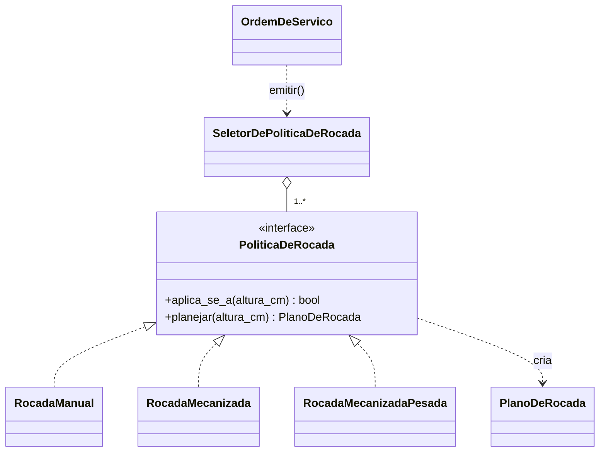
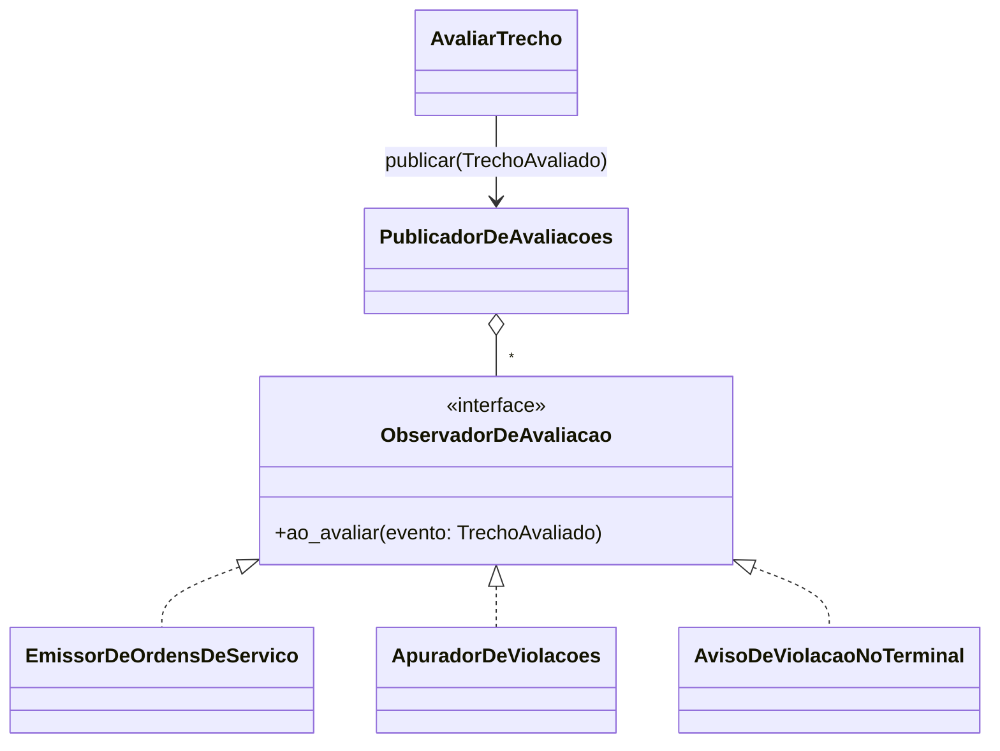

# Registro de refatorações

Cada refatoração entra por um pull request próprio, com commits `refactor:` pequenos e a mesma suíte
de testes verde antes e depois. Os testes de caracterização de `tests/aplicacao/` foram escritos
**antes** de qualquer refatoração para congelar o comportamento do caso de uso principal.

| # | Code smell | Técnica | Dívida paga | Branch |
|---|---|---|---|---|
| 1 | Função longa, números mágicos, duplicação, regra fora do domínio | Extrair função, mover método, constantes nomeadas | DT-01 | `refactor/regras-de-risco-no-dominio` |
| 2 | Acoplamento da aplicação a um adaptador concreto | Portas e adaptadores com injeção de dependência | DT-02 | `refactor/portas-e-adaptadores` |
| 3 | Cadeia de `if` por tipo | Padrão Strategy | DT-03 | `refactor/strategy-politica-de-rocada` |
| 4 | Caso de uso que conhece outro contexto | Padrão Observer | DT-04 | `refactor/observer-trecho-avaliado` |

---

## Refatoração 1 — Regras de risco no domínio

**Code smells:** função longa (`AvaliarTrecho.executar`, ~70 linhas, `noqa: C901` para o ruff
aceitar), números mágicos (`30`, `2`, `7`, 48 h), **duplicação** (o cálculo de taxa, projeção e nível
existia copiado em `ConsultarFilaDeTrechos._avaliar`) e regra de negócio fora do domínio.

**Antes** — `aplicacao/avaliar_trecho.py` (trecho):

```python
dias_ate_limite = None
if altura >= 30:
    dias_ate_limite = 0
elif taxa is not None and taxa > 0:
    dias_ate_limite = math.floor((30 - altura) / taxa)

if altura >= 30 or (dias_ate_limite is not None and dias_ate_limite <= 2):
    nivel = NivelDeRisco.CRITICO
elif dias_ate_limite is not None and dias_ate_limite <= 7:
    nivel = NivelDeRisco.ATENCAO
```

**Depois** — o caso de uso só orquestra; a regra mora no agregado:

```python
avaliacao = trecho.avaliar(hoje)  # monitoramento/dominio/trecho.py
if avaliacao.exige_ordem_de_servico:
    ordem = _emitir_ou_reavaliar_ordem(dados, avaliacao)
if avaliacao.violou_limite:
    violacao = _apontar_violacao(dados, avaliacao, hoje)
```

**O que melhorou:** a regra contratual existe em um lugar só e com nome; mudar o limite de 30 cm é
editar uma constante e a fila e a ordem nunca mais divergem. A função principal caiu de ~70 para
~15 linhas e o `noqa` sumiu. Os 103 testes de caracterização passaram sem alteração em cada um dos
4 commits `refactor:`.

**Commits:** constantes → taxa em `Trecho` → classificação em `Trecho.avaliar` → prioridade/prazo em
`PlanoDeRegularizacao`.

---

## Refatoração 2 — Portas e adaptadores (componente redesenhado)

**Code smell:** acoplamento excessivo — a camada de aplicação dependia de um adaptador concreto.
Os 5 casos de uso faziam `ArmazenamentoEmArquivo(self._caminho_dos_dados)` dentro de `executar`, e
os testes de caso de uso gravavam em disco.

**Antes** — `aplicacao/avaliar_trecho.py`:

```python
class AvaliarTrecho:
    def __init__(self, caminho_dos_dados: Path) -> None:
        self._caminho_dos_dados = caminho_dos_dados

    def executar(self, trecho_id: str, hoje: date) -> ResultadoDaAvaliacao:
        dados = ArmazenamentoEmArquivo(self._caminho_dos_dados)  # adaptador criado por dentro
        trecho = dados.buscar_trecho(trecho_id)
```

**Depois** — o caso de uso recebe as portas; quem escolhe o adaptador é a raiz de composição (CLI):

```python
class AvaliarTrecho:
    def __init__(
        self,
        trechos: RepositorioDeTrechos,  # porta declarada em monitoramento/dominio/portas.py
        ordens: RepositorioDeOrdens,  # portas declaradas em manutencao/dominio/portas.py
        violacoes: RepositorioDeViolacoes,
    ) -> None: ...
```

| Porta (domínio) | Adaptador em memória | Adaptador em arquivo |
|---|---|---|
| `RepositorioDeTrechos` | `RepositorioDeTrechosEmMemoria` | `RepositorioDeTrechosEmArquivo` |
| `RepositorioDeOrdens` | `RepositorioDeOrdensEmMemoria` | `RepositorioDeOrdensEmArquivo` |
| `RepositorioDeViolacoes` | `RepositorioDeViolacoesEmMemoria` | `RepositorioDeViolacoesEmArquivo` |

**O que melhorou:** trocar o arquivo por banco no Checkpoint 3 é escrever um adaptador novo; nenhum
caso de uso muda. Os testes dos casos de uso rodam com o adaptador em memória, sem disco, e os testes
de contrato (`tests/contratos/`) provam que os dois adaptadores se comportam igual. Medido pelo
`import-linter`: antes, o contrato "aplicação não importa adaptadores" **quebrava em 5 imports**;
depois, **3 contratos mantidos, 0 quebrados**, verificados a cada pull request.

**Nota honesta:** um teste de caracterização dependia de o armazenamento em arquivo devolver cópias
dos objetos. Ele foi corrigido num commit `test:` próprio, **antes** da refatoração, sem mudar a regra
que verifica; a partir daí a mesma suíte passou antes e depois de cada commit `refactor:`.

---

## Refatoração 3 — Padrão Strategy na política de roçada (GoF comportamental)

**Problema real:** `OrdemDeServico.emitir` decidia método de roçada, número de equipes e EPI por uma
cadeia de `if/elif` sobre a altura. Cada método novo que a Motiva adotar (roçada em talude, química,
de canteiro central) exigiria abrir a entidade mais importante da Manutenção (DT-03).

**Antes** — `manutencao/dominio/ordem_de_servico.py`:

```python
if altura_cm <= 50:
    metodo = "Roçada manual com roçadeira costal"
    equipes = 1
    epi = epi_basico
elif altura_cm <= 100:
    metodo = "Roçada mecanizada com trator e roçadeira acoplada"
    ...
else:
    metodo = "Roçada mecanizada pesada com trator e apoio manual"
    ...
```

**Depois** — `manutencao/dominio/politicas_de_rocada.py` e a entidade só pede o plano:

```python
plano = seletor.planejar(altura_cm)  # dentro de OrdemDeServico.emitir
```

| Papel no padrão | Classe no VegeTrack |
|---|---|
| Strategy | `PoliticaDeRocada` (interface: `aplica_se_a`, `planejar`) |
| ConcreteStrategy | `RocadaManual`, `RocadaMecanizada`, `RocadaMecanizadaPesada` |
| Context | `SeletorDePoliticaDeRocada` (usado por `OrdemDeServico.emitir`) |
| Produto da estratégia | `PlanoDeRocada` (value object: método, equipes, EPI) |



**Por que não é abuso:** havia três variações reais com regra e EPI diferentes, e o backlog já prevê
mais. `SELETOR_PADRAO` é uma instância compartilhada, mas **não é Singleton**: é imutável, sem
estado, e pode ser substituída por parâmetro (`OrdemDeServico.emitir(..., seletor=...)`), como o teste
`test_politica_nova_entra_sem_alterar_a_ordem_de_servico` faz.

**O que melhorou:** método novo é uma classe nova; a entidade não muda. Um teste varre de 0 a 300 cm
para garantir que as faixas padrão não se sobrepõem nem deixam buraco. Os testes de emissão
existentes passaram sem alteração.

---

## Refatoração 4 — Padrão Observer nas reações à avaliação (GoF comportamental)

**Problema real:** `AvaliarTrecho` (Monitoramento) decidia prioridade, emissão de ordem e violação,
que são regras da Manutenção (DT-04). Qualquer reação nova a uma avaliação, como avisar a
coordenação, exigia mexer no caso de uso mais crítico do sistema.

**Antes** — `aplicacao/avaliar_trecho.py`:

```python
avaliacao = trecho.avaliar(hoje)
if avaliacao.exige_ordem_de_servico:
    ordem = _emitir_ou_reavaliar_ordem(self._ordens, avaliacao)
if avaliacao.violou_limite:
    violacao = _apontar_violacao(self._violacoes, avaliacao, hoje)
```

**Depois** — o Monitoramento só anuncia o que aconteceu:

```python
avaliacao = trecho.avaliar(hoje)
self.publicador.publicar(TrechoAvaliado.de(avaliacao))
```

| Papel no padrão | Classe no VegeTrack |
|---|---|
| Subject | `PublicadorDeAvaliacoes` (`aplicacao/publicador_de_avaliacoes.py`) |
| Observer | `ObservadorDeAvaliacao` (interface `ao_avaliar`) |
| ConcreteObserver | `EmissorDeOrdensDeServico`, `ApuradorDeViolacoes` (`aplicacao/reacoes_da_manutencao.py`), `AvisoDeViolacaoNoTerminal` (`adaptadores/cli.py`) |
| Evento | `TrechoAvaliado` (`monitoramento/dominio/eventos.py`) |



**O que melhorou:** o evento `TrechoAvaliado` é a relação cliente-fornecedor entre os dois bounded
contexts, agora explícita no código. A prova: o commit `feat:` seguinte acrescenta o aviso no terminal
como terceiro observador **sem alterar uma linha de `AvaliarTrecho`**. Os testes de caracterização
passaram sem alteração.

**Limite assumido:** `AvaliarTrecho` ainda consulta os repositórios de ordens e violações para montar
o `ResultadoDaAvaliacao` (somente leitura). Não decide mais nada da Manutenção.
